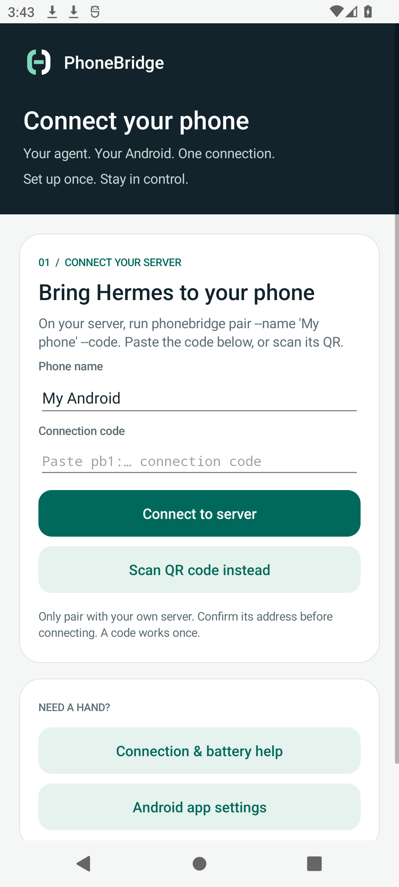
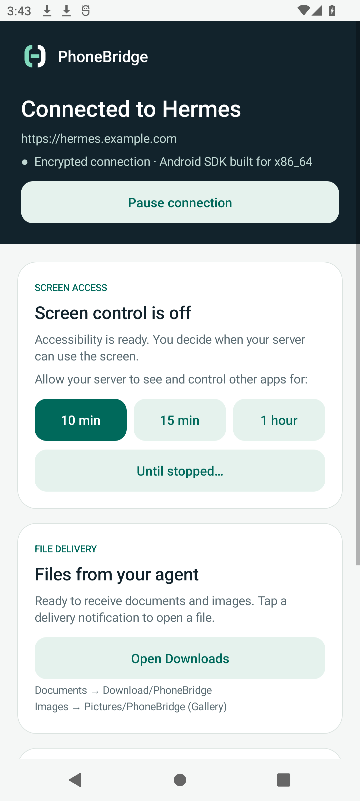
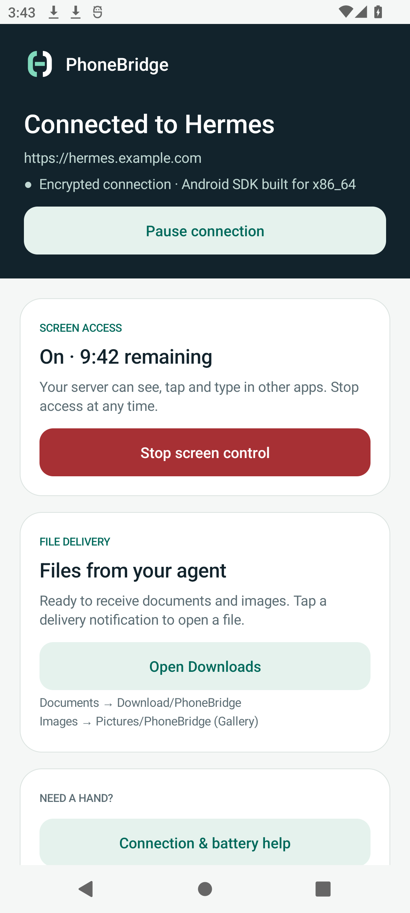

# PhoneBridge

**Let a Hermes agent on your server use your Android phone and send you files.**

Ask Hermes to check something in a phone app, type a reply, or deliver a report. PhoneBridge connects your phone to your server. Screen access is off until you turn it on; receiving files does not require screen access.

| Screen control | Files from your agent |
| --- | --- |
| Read visible text, take screenshots, tap, swipe, type, press Back/Home/Recents | Save documents to `Download/PhoneBridge` and images to `Pictures/PhoneBridge` |
| Requires Android Accessibility and a duration chosen on the phone | Works while connected, without Accessibility |

Android 12 or newer. No root, ADB or inbound phone port. The phone opens an authenticated WebSocket to your HTTPS server. PhoneBridge is a remote-control companion for a server-hosted agent.

## What it looks like

Screenshots from the Android app with synthetic example connection states. [Capture source](android/app/src/androidTest/java/org/nous/phonebridge/OwnerUiTourTest.kt).

| Connect your phone | Everyday use | Screen access on |
| --- | --- | --- |
|  |  |  |

## Connect it

You need a Linux server running Python 3.11+, a hostname with HTTPS, and an Android phone. Run the CLI and Hermes on the same server as the relay.

### 1. Run the server

Clone the repository:

```sh
git clone https://github.com/freQuensy23-coder/hermes-phonebridge.git
cd hermes-phonebridge
python3 -m venv .venv
. .venv/bin/activate
pip install ./server ./cli
mkdir -m 700 -p "$HOME/.local/share/phonebridge"
```

Generate a token with `python -c 'import secrets; print(secrets.token_urlsafe(48))'`. Save it privately and set these variables in the server's environment:

```sh
export PHONEBRIDGE_ADMIN_TOKEN='<the generated token>'
export PHONEBRIDGE_PUBLIC_URL='https://phone.example.com'
export PHONEBRIDGE_DB_PATH="$HOME/.local/share/phonebridge/phonebridge.sqlite3"
uvicorn phonebridge_server.app:create_app --factory --host 127.0.0.1 --port 18940 --proxy-headers --forwarded-allow-ips 127.0.0.1 --no-access-log
```

Put nginx with a valid TLS certificate in front of it. Expose only `/v1/pair/claim`, `/v1/device/ws`, `/v1/device/files/` and `/healthz`; keep administrative routes on loopback. The checked-in [HTTPS provisioner](deploy/provision_https.py) contains the nginx configuration. [Deployment guide](deploy/README.md) covers systemd and the repository's CI artifact deployment process.

### 2. Pair the phone

Install `phonebridge-vN.apk` from the latest [release](https://github.com/freQuensy23-coder/hermes-phonebridge/releases/latest), signed with the project's private release key, or build the debug APK under [Build and check](#build-and-check) with your local signing key. **Replace the old preview APK** as described under [Security and preview builds](#security-and-preview-builds).

On the server, in another terminal with the virtual environment active:

```sh
export PHONEBRIDGE_URL='http://127.0.0.1:18940'
export PHONEBRIDGE_TOKEN='<the same admin token>'
phonebridge pair --name 'My phone' --code
```

Open PhoneBridge, paste the `pb1:…` code and confirm your server's address. Or create a QR with `phonebridge pair --name 'My phone' --qr /private/path/pair.png` and scan it. Codes expire and work once. The app starts the connection after pairing.

Allow notifications to see connection status and received files. For screen control, enable PhoneBridge in Android Accessibility settings, return to the app, then choose **10 min**, **15 min**, **1 hour**, or **Until stopped**. On Samsung, you may first need App info → ⋮ → Allow restricted settings.

### 3. Give Hermes the skill

```sh
phonebridge install-skill
phonebridge devices list
```

Use `phonebridge install-skill --replace` to update an existing installation. The skill teaches Hermes the available CLI commands and their limits.

## Try it from the terminal

Replace `DEVICE` with the ID printed by `phonebridge devices list`.

```sh
phonebridge files send DEVICE ./report.pdf --wait
phonebridge images send DEVICE ./photo.jpg --wait
phonebridge screen tree DEVICE --wait
phonebridge screen screenshot DEVICE --output /private/path/screen.jpg
phonebridge screen input DEVICE --text 'Hello from Hermes' --wait
phonebridge screen global DEVICE --action home --wait
```

Screen commands require active screen access. Typing targets the focused field unless you pass `--resource-id`. Screenshots are scaled; use the returned native screen bounds when choosing tap coordinates. A dispatched action is not proof the desired UI change happened: inspect the screen again. See [screen control](docs/screen-control.md), [file delivery](docs/file-delivery.md) and [CLI commands](cli/README.md).

## Pause, stop or remove access

**Stop screen control** ends screen access and keeps file delivery connected. **Pause connection** stops both and clears screen consent; resuming does not re-enable screen control. You can also stop the connection from its Android notification.

**Forget server** erases credentials, local command history and queued events from this phone. Files already saved to Downloads/Gallery remain. To remove the server registration as well, run `phonebridge devices revoke DEVICE` on the server.

If delivery is unreliable, choose Unrestricted battery use for PhoneBridge. On Samsung, also remove it from sleeping/deep-sleeping apps. Android force-stop prevents automatic reconnect until the app is opened again.

## Security and preview builds

Your server and its admin token have broad access to your phone while screen control is on. Keep that token out of chat, logs and screenshots. Pair only with a server you control. HTTPS protects transit; it does not hide screen results or files from the server, agent or their operators. Password fields are omitted from UI-tree text, but screen access can still expose private information in other apps.

The app encrypts device credentials with Android Keystore, disables backup, protects its window from screenshots/Recents, and refuses remote input on its own controls. The server hashes pairing/device tokens and checks per-device file access. See the [security review](docs/security-review.md) for findings, fixes and limits.

**The old `mvp-preview-0f059c7` APK was signed with a private key published in this repository.** Anyone holding that key can sign a replacement APK. Deleting the key from the branch cannot make installed copies trustworthy. Uninstall that preview, install a build signed by a private key you trust, and pair again. Normal debug builds now use the developer's local Android debug key; use a private release key for distribution. Releases from `main` are signed with the private release key described under [CI/CD](#cicd).

## Build and check

JDK 17 and Android SDK 35 are required for Android; the minimum supported phone is API 31.

```sh
python -m pip install -e './server[test]' -e './cli[test]'
python -m pytest server/tests cli/tests deploy/tests ci/tests
cd android
./gradlew testDebugUnitTest assembleDebug assembleDebugAndroidTest
```

CI exercises the server/CLI, Android unit tests and emulator flows on API 31 and 35. The owner UI screenshot test uses example data; the separate end-to-end screenshot tour pairs against an isolated real server. Protocol: [contract](docs/contract.md). Android restrictions: [support matrix](docs/support-matrix.md).

## CI/CD

`.github/workflows/ci.yml` runs on every push and pull request:

- `lint`: ruff, shellcheck, actionlint and Android lint.
- `typecheck`: mypy with `check_untyped_defs` (`mypy.ini`; the host-pinned `deploy/rollout.py` keeps signature-only checking) and Kotlin compilation of main, unit-test and instrumentation sources.
- `no-comments`: `ci/check_no_comments.py` fails on any comment or docstring in tracked code, YAML, shell, TOML, XML and Docker files.
- `python` and `android-build`: unit tests, wheels and debug/instrumentation/release APKs.
- `image`: builds `server/Dockerfile` and smoke-tests `/healthz`.
- `security`, `offline-runtime` and `android-e2e`: dependency and workflow audits, the offline wheel install, and emulator instrumentation on API 31 and 35.

Main runs are queued, not replaced, so every push to `main` that passes all gates is released as `vN`, where N is the highest existing `vN` tag plus one; a rerun of the same commit reuses its existing tag and completes the same release. The `release` job signs the APK built in the same run with the stable release key, checks its certificate against `PHONEBRIDGE_SIGNER_SHA256`, pushes `ghcr.io/frequensy23-coder/phonebridge-server:vN` and `:latest`, and publishes `phonebridge-vN.apk`, both wheels and `SHA256SUMS` as a GitHub release. The APK has `versionCode` N and `versionName` `0.1.0+N`.
